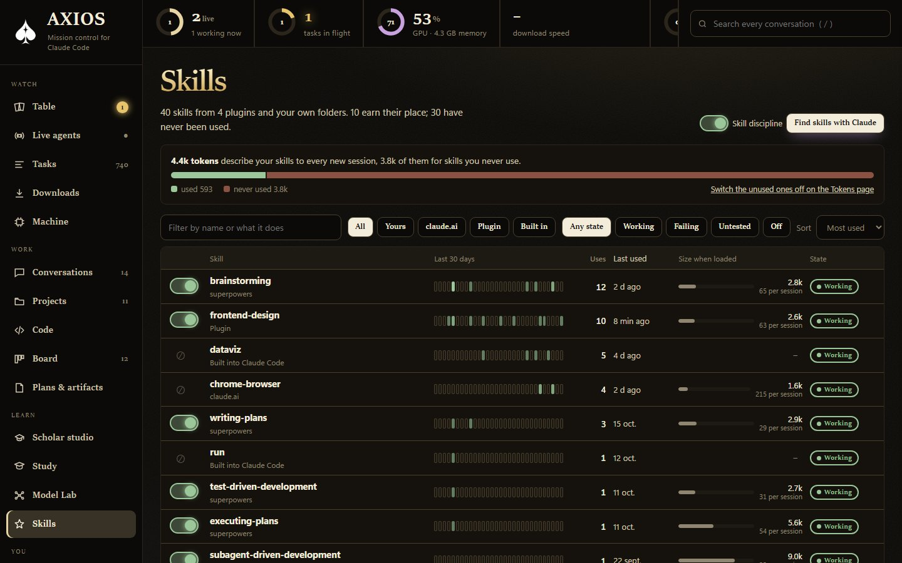
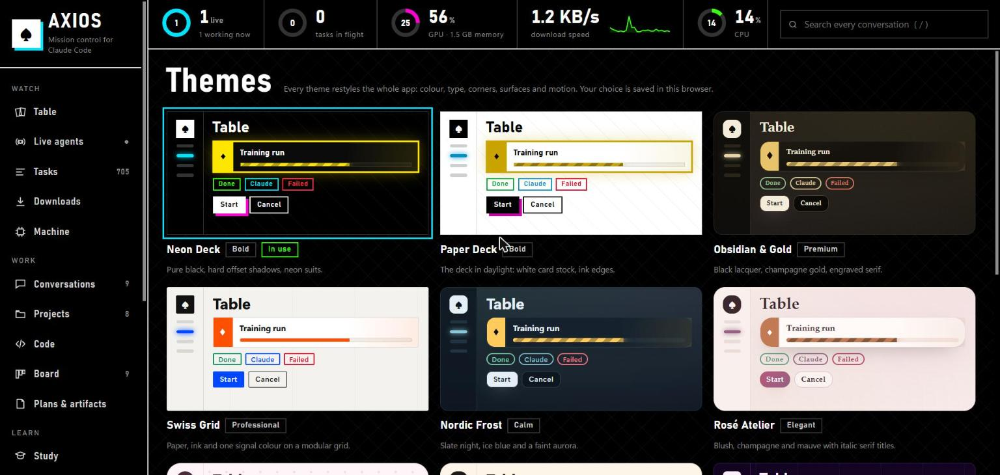

<p align="center">
  <picture>
    <source media="(prefers-color-scheme: dark)" srcset="public/brand/anchor-white.png">
    
  </picture>
</p>

<h1 align="center">Anchor</h1>

**Keeps Claude Code and Codex steady on your limits.** Anchor is a token governor and dashboard for every Claude Code
session on your computer, and it works the same way in Codex. It stops a big session from re-paying an expired prompt cache, tells Claude when to `/compact` or
`/clear`, shows where your tokens went and what to change, and keeps your skills lean. It also shows what Claude and its
agents are doing right now (with the real diff of every file edit), every project and conversation, and when your limits
reset. **It runs only on your computer** (127.0.0.1): nothing is sent anywhere, and it needs no account, key or build
step.



## Install (one minute)

You need **Claude Code** and **Node.js 18 or newer** (`node --version`). In Claude Code, run:

```
/plugin marketplace add kreht1/anchor
/plugin install anchor@anchor
```

(A local copy works too: `/plugin marketplace add C:\path\to\anchor`.)

Then restart Claude Code. That's all:

- **The dashboard starts by itself** with your next session, in the background, at http://127.0.0.1:4777.
- **`/anchor`** opens it. `/anchor usage` shows your current 5-hour window, the week, and when each resets.
  `/anchor live`, `/anchor skills`, `/anchor account` and so on open one page.
- **Claude uses it on its own:** the plugin's `anchor` skill makes Claude put planned work on the board and track long
  downloads, and answer "how much usage do I have left?" from your local data.

Update with `/plugin update anchor`, remove with `/plugin uninstall anchor`. Your board stays in `~/.anchor`.

## What you get

| Page | What you see |
|---|---|
| **Table** | What is running now, live sessions and their latest messages, downloads, what's next on the board |
| **Live agents** | Claude and every subagent at work: what each is doing, every step, and the before/after diff of each file edit as it happens |
| **Tasks** | Every background command, download and agent, with status, progress read from its output, and a live log |
| **Downloads** | Network speed, downloads Claude started, browser downloads, and folders you watch (size, speed, time left) |
| **Machine** | GPU, CPU, memory and disks, and the processes worth knowing about |
| **Conversations** | Every session by project, with a reader that follows live chats, search across all of them (`/`), and a message box that sends a turn into a conversation |
| **Projects** | One page per folder Claude worked in: activity, sessions, tools and skills used, files changed, tasks, memory, CLAUDE.md, git, its code, studies, and its graphify graph if it has one |
| **Code** | A read-only code browser for those folders, with Claude's recent edits to each file and "Explain with Claude" |
| **Board** | Planned, in progress, waiting, done; you and every Claude session add to it |
| **Plans & artifacts** | Plans from plan mode, published artifacts, and cost by session |
| **Study** | Point Claude at a folder: what it is about, the code function by function (what each part does and why), the architecture, an onboarding guide, or your own question |
| **Skills** | A ledger of every installed skill (yours, plugins, claude.ai, built-in, project): on/off, 30 days of use as a strip of days, last used, its size when loaded and what it costs every session just by being listed, and its health. Sort by most used, used lately or heaviest. **Find skills with Claude** searches GitHub for your task; a found skill is downloaded into quarantine and scanned, and installed only when you say so |
| **Tokens** | Where your tokens went (what every session reads up front, big tool outputs, re-read files, skills loaded, cache rebuilds, long sessions) and what to change, biggest saving first; the token saver switch |
| **Account & usage** | Who is signed in and on which plan, the current 5-hour window and the week with live countdowns to each reset, usage by day and model, every limit notice, every session |
| **Scholar studio** | Claude makes slide decks, Word documents, Excel workbooks, LaTeX papers, academic posters, publication figures and motion-design videos with your skills and the tools on your computer. You set every option (format, length, style, palette, fonts, citations, engine...), give source files, watch it work, preview the results, and revise in the same conversation |
| **Providers** | Keep working when your plan hits a limit: OpenRouter, GroqCloud, Ollama or LM Studio on your computer, or any compatible endpoint. Test it, then launch Claude Code on it in a new terminal (or `anchor claude <profile>`); your normal sessions stay on your plan |
| **Skills on every message** | Each message you send is matched against your skills, and the best one to three are named to Claude before it answers. The Skills page shows how often a named skill was then used, and lets you try the matcher on any sentence |
| **Guard** | Every command and file write Claude Code makes is checked first: mass deletes, workspace wipes, destroyed git history, emptied Recycle Bin, deleted or overwritten models and datasets, disk tools, and protected paths are blocked; risky actions (git reset --hard, recursive deletes, rewriting most of a file) ask you. Rules and protected paths are yours to set; everything it stops is logged |
| **Model Lab** | Open any checkpoint (PyTorch, safetensors, NumPy, GGUF, ONNX, Keras) and see it down to the neuron: layers as columns of neurons, every connection a real sampled weight, signals flowing along the strongest ones; per-layer weight heatmaps, histograms, statistics, conv filters, and the full module tree. Pickles are read with a locked-down unpickler: nothing in the file runs |
| **Themes** | 11 full themes: Neon Deck, Paper Deck, Obsidian & Gold, Swiss Grid, Nordic Frost, Rosé Atelier, Sakura Mochi, Bento Pop, Synthwave '84, Phosphor, Dragonbone |



## Guard

With the plugin, a PreToolUse hook checks every Bash, PowerShell, Write and Edit call before it runs, in every
session and in every permission mode (bypass included). Critical rules block outright; high-risk ones ask you.

| Blocked by default | Asks you by default |
|---|---|
| `rm -rf` of ., ~, /, a drive or the home folder | recursive delete of a folder (`rm -rf src`) |
| deleting `.git`, `git filter-branch`, erasing reflog | deleting many files (`rm *.py`, `find -delete`) |
| deleting, moving away or overwriting models and datasets | `git reset --hard`, `git clean -f`, `git push --force` |
| emptying the Recycle Bin, `shred`, `cipher /w` | scaffolding a new project over the current one |
| `format`, `diskpart`, `mkfs`, `dd of=/dev/…`, shutdown | replacing most of a file in one write |
| anything under a path you protect | deleting files from an inline script |

Build output and caches (`node_modules`, `dist`, `__pycache__`…) can always be deleted. A blocked command is never
retried another way: Claude tells you what it wanted to run. Change any rule, add protected paths and test commands on
the **Guard** page.

## Skill discipline

Like superpowers, Anchor makes Claude **check its skills before every task and use the ones that fit**. With the plugin,
each session starts with a short rule (about 250 tokens): look for a matching skill first, even on a small chance; use
process skills (planning, debugging, testing) before implementation ones; prefer the skills proven for you; avoid the
ones you marked failing or switched off. Anchor fills in those lists from your real usage and your verdicts on the Skills
page. Switch it off there with **Skill discipline**.

## Token saver

On by default, for everyone who installs Anchor. Nothing to download or set up.

- **Lean sessions.** Each session starts with a short set of working habits: search before reading, read line ranges,
  cap command output, batch tool calls, never re-read what was just edited, PDFs a few pages at a time, wide searches in
  an Explore subagent, smaller models for mechanical subagents, and `/compact` or `/clear` at the right moment. It
  costs about 120 tokens and saves far more.
- **No wasted skill loads.** A loaded skill stays in the conversation (1k to 12k tokens). Anchor names a skill only on
  clear evidence, never for everyday words like "send" or "check", and never twice in a session.
- **Two skills included.** `token-saver` is the full playbook for heavy work. `token-audit` measures your own usage
  and fixes the biggest items with you. Ask Claude "audit my tokens".
- **Tokens page / `anchor tokens`.** Shows where the last day, week or month went, from your own transcripts:
  - what every session reads before any work;
  - the largest tool results and files read again and again;
  - skills loaded;
  - the prompt cache being rebuilt after an hour away;
  - very long sessions.

  Each finding comes with its fix, biggest saving first.
- **In the Claude app and Cowork too.** `anchor export-skills` writes `token-saver.zip` and `lean-chat.zip` for claude.ai
  (Settings › Capabilities › Skills) and `anchor-lean-cowork.zip`, a Cowork plugin with both skills and a `/handoff`
  command (Customize › Plugins › + › Upload). Anchor cannot measure claude.ai or Cowork usage: there are no local
  transcripts for them.

Turn it off with the switch on the Tokens page or `anchor saver off`.

## Token governor

For heavy users, most of the limit is not tool output: it is long conversations re-read on every reply, and the
prompt cache rebuilt in full after a break. Anchor governs the session itself.

| what | how | change it |
|---|---|---|
| **Cache-cold guard** | Coming back to a big session (60k+) after its cache expired, Anchor stops that one message, shows the cost, and offers `/compact`, `/clear`, or sending the same message again. The cache lifetime is read from the session. Scripted (SDK) sessions are never stopped. | `anchor cacheguard block\|warn\|off` |
| **Context governor** | Past 120k, 200k and 300k Claude suggests `/compact` at the next milestone (once per level); an unrelated request in a big session gets a `/clear` suggestion. | `anchor governor on\|off` |
| **Status line** | `Anchor · ctx 142k · cache 38m · 5h 41% · wk 23%` after every reply. | `anchor statusline install --apply` |
| **Lean start** | Switches off skills and plugins you never use; claude.ai skills are listed with where to turn them off. | `anchor lean --apply` or the Tokens page |
| **Token tools from the web** | RTK, context-mode, Serena, Context7: vetted and ranked against your own week, installed only when you click. | `anchor catalog`, Tokens page |

## When you hit a limit: other providers

Claude Code can run on other models. Anchor sets that up without touching your normal sessions:

| Provider | How | Cost |
|---|---|---|
| **Ollama** (0.14+) or **LM Studio** | on your computer | free, fully local |
| **GroqCloud** | through the Anchor bridge | free tier, very fast |
| **OpenRouter**, any model | through the Anchor bridge | free `:free` models, or pay as you go |
| **OpenRouter**, Claude models | direct | pay as you go |
| **Google Gemini** (AI Studio key) | through the Anchor bridge | free tier (Flash models, daily limits) |
| **Claude Code Router** | direct, to its local gateway | depends on what you route it to |
| **A failover chain** of any of these | through the Anchor bridge | each in turn |
| Any Anthropic- or OpenAI-compatible endpoint | direct or through the bridge | depends |

On the **Providers** page: add one, paste a key or name an environment variable, load the model list, **Test**, then
**Launch Claude Code** (new terminal, in a project folder, fresh or continuing a conversation). Star one as your
**fallback** and the Account page offers it with one click when you hit a limit. From a terminal: `anchor claude <profile>`.

- **Failover chain:** list providers in order (say Groq free, then Gemini free, then Ollama). Each request goes to the first one
  that answers; one that is rate-limited, out of quota, down or missing its model is skipped and rested for a while. The
  Providers page shows which provider answered and what was skipped.
- **Claude Code Router** ([musistudio/claude-code-router](https://github.com/musistudio/claude-code-router), the most popular
  router): Anchor installs it (one click, about 25 MB), starts and stops it, opens its own UI, launches its agent profiles, and
  can use its gateway as one Anchor provider, inside a failover chain too. CCR keeps its own settings; Anchor never edits them
  or shows its management token.
- Pick models with **tool calling**; Claude Code is an agent. Quality and speed depend on the model.
- **The bridge** runs inside Anchor on 127.0.0.1. It translates Claude Code's requests (messages, tools, images,
  streaming) to the OpenAI format, and only accepts callers holding a local token that Anchor gives the Claude Code it
  launches.
- **Keys:** from an environment variable (Anchor never stores the key), or saved by Anchor, encrypted with your Windows
  account (DPAPI; on macOS and Linux, a file only you can read). Keys are never shown again or sent anywhere except to
  that provider.

## Scholar studio

Pick what to make (slide deck, Word document, Excel workbook, LaTeX paper, academic poster, publication figures, motion-design
video), write the brief, set the options, list source files, and press **Make it**. Each piece gets its own folder in
`Documents/Anchor Studio`; your sources are copied in, so the originals are never touched. Claude uses your skills (pptx,
docx, xlsx, pdf...) and their scripts, checks its own output, and writes a README on how to rebuild it. Results show up as
previews (PDF, images, video; Office files through LibreOffice), and **Revise** continues the same conversation.

The **toolbox** shows what the computer has and installs what is missing with one click (Python Office libraries about
5 MB, LaTeX about 150 MB, LibreOffice about 350 MB). Without LaTeX, papers are still produced, ready for Overleaf. Videos
need nothing extra: Python and ffmpeg render them; Manim and Remotion are options.

In the studio, Claude's file tools stay inside the project folder, and shell commands are limited to document tools
(Python, Node, ffmpeg, LaTeX, LibreOffice and basic file commands).

## Privacy and safety

- **Local only:** the server listens on 127.0.0.1, rejects other host names (DNS rebinding) and refuses cross-site
  writes. There are no dependencies to download and no telemetry.
- **What it reads:** Claude Code's own files in `~/.claude` (transcripts, sessions, plans, skills) and, for the account
  page, your profile fields (name, email, plan) from `~/.claude.json`. It **never** reads `.credentials.json` or any
  login token. Keys, tokens and webhook URLs are masked before any text is shown.
- **Code browsing** is read-only, limited to folders Claude has worked in, and hides files that may hold secrets
  (`.env`, SSH keys, `*.pem` and similar).
- **Claude runs started from Anchor** (study, explain, skill finder, chat, graph build) use your own `claude` CLI with a
  fixed tool sandbox: `--tools` limits which tools exist and `--permission-mode dontAsk` refuses everything else.
  Studies and explanations are read-only; the chat box can edit files only if you tick the box, and never runs
  commands. They default to Sonnet at medium effort and show their cost.
- **Usage figures** come from your transcripts. Reset times are exact when Claude Code told you about a limit; the
  percentages are estimates calibrated on your own past limit hits. `/usage` in Claude Code is the exact figure.
  Anchor cannot reset a limit; it shows when each one resets.
- **Switching skills:** your own skills are switched off by moving their folder into `~/.anchor` and
  back. A plugin is switched in `~/.claude/settings.json`, which is backed up first.

## Codex

Anchor works in **Codex** (OpenAI's coding agent) too, with the same aims: the token saver, the context and `/compact`
prompts, Guard, skill hints, the board and your usage. Codex reads Anchor's plugin as it is, so it is one install:

```
codex plugin marketplace add kreht1/anchor
codex plugin add anchor@anchor
```

**Step-by-step guide for Codex users: [docs/CODEX.md](docs/CODEX.md).**

Then, inside Codex, run `/hooks` once and approve Anchor's three hooks (Codex asks before running any plugin hook).
If Anchor is already in Claude Code, `anchor codex setup` (or **Set up Codex** on the dashboard's Codex page) does all
of it, adds a short board note to `~/.codex/AGENTS.md`, and brings your proven Claude skills along.

What changes in Codex, so it feels native there:

- **Session note and token saver** in Codex's terms: its shell and `apply_patch`, `$skill` and SKILL.md instead of the
  Skill tool, `/new` where Claude has `/clear`.
- **Governor**: the context tiers and the topic switch work the same, read from Codex's own session logs. The cache-cold
  stop stays off, because Codex does not report how long its prompt cache lives.
- **Guard** reads Codex's shell commands and its `apply_patch` edits (deleted files, `.git`, model files, big
  removals). Codex has no "ask" answer yet, so a risky (not dangerous) call goes through with Guard's warning attached.
- **Usage**: `anchor codex usage` and the Codex page show tokens, cache share, and Codex's own limit windows with
  their reset times, exactly as Codex reported them.

### Skill bridge: Claude skills in Codex

Codex reads the same `SKILL.md` format, but many skills were written for Claude's tools. The **Codex** page lists every
Claude skill you have (your own, plugin skills, claude.ai skills) with an honest verdict:

- **Works as-is**: plain instructions.
- **Adapted**: it names Claude tools (Read, Edit, TodoWrite, the Skill tool, subagents, WebFetch…). Anchor adds a short
  "Running in Codex" note that maps only those tools to Codex's, resolves `${CLAUDE_PLUGIN_ROOT}` and
  `${CLAUDE_SKILL_DIR}` so scripts and references still load, and names sibling skills the way Codex calls them.
- **Claude-only**: it is built on something Codex does not have (artifacts, Claude in Chrome, claude.ai connectors,
  the Claude app). You can still send it, but it will not work the same.

**Send to Codex** copies the skill to `~/.agents/skills/<name>`; your original is never changed. **Sync** refreshes
ports whose source changed. **Find skills** searches well-known collections (caveman, superpowers, Anthropic's skills,
science skills…) and GitHub; each download is scanned in quarantine before you choose **Claude**, **Codex** or **both**.

```
anchor codex status                 # what is set up
anchor codex skills                 # every Claude skill with its Codex verdict
anchor codex port superpowers:brainstorming anthropic-skills:pdf
anchor codex sync                   # re-port skills whose source changed
anchor codex unport brainstorming
```

## Without the plugin

```
git clone https://github.com/kreht1/anchor anchor && cd anchor
node bin/anchor.js start        # starts the server and opens the dashboard
node bin/anchor.js help         # board, watch, job, usage and the other commands
```

On Windows, `node bin/anchor.js install` also adds autostart at login, a desktop shortcut, an `anchor` command and a note in
`~/.claude/CLAUDE.md`; `node bin/anchor.js uninstall` removes them.

## Commands

`anchor` below is `node "$HOME/.anchor/anchor.js"` (the plugin keeps this path current) or `node bin/anchor.js`.

```
anchor open [--page live|projects|code|study|skills|tokens|account|themes|board]
anchor usage                                   # 5-hour window, week, reset times
anchor add "Run the tests" -p my-app --doing   # board: then anchor done <id> · anchor wait <id> · anchor list -p my-app
anchor watch "C:\data\big-dataset" --label "Dataset" --gb 12
anchor job "C:\runs\train\log.txt" --label "Training" --pid 12345   # a long run started outside Claude
```

## Files

- `server.js`: the HTTP server and API. `bin/anchor.js`: the command.
- `lib/`: transcripts and tasks (`transcripts.js`), live feed (`activity.js`), projects (`projects.js`), graphify graphs
  (`graph.js`), code browsing (`fsview.js`), skills and the GitHub installer (`skills.js`, `skillhub.js`), Claude runs
  (`runner.js`), usage and limits (`usage.js`), providers, the bridge and launching (`providers.js`, `bridge.js`, `launch.js`), machine telemetry (`system.js`), the board (`store.js`), masking (`redact.js`).
- `public/`: the app (plain JavaScript, no build); `public/ext/` holds the newer pages and `themes.css` the themes.
- `.claude-plugin/`, `skills/anchor/`, `commands/`, `hooks/`: the Claude Code plugin.
- `test/smoke.js` and `test/bridge.js`: end-to-end tests of the API, its security guards and the provider bridge (`npm test`).
